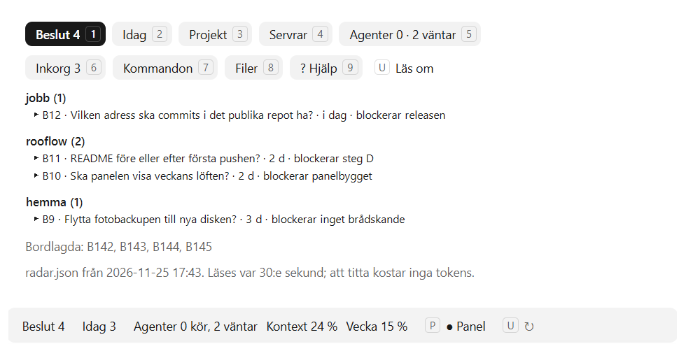

# RooFlow

A calm overview for people who run many projects and many Claude agents at once. RooFlow keeps your projects, agents,
promises and decisions as plain Markdown and JSON files in a folder of your own, and shows them in a band above the prompt
and a panel beside the chat.



*The Radar panel (Decisions tab) and the band, here with the labels in Swedish (`"language": "sv"`) and sample data.*

## Why

A Claude session forgets. RooFlow does not try to fix that; it moves the memory into files. The session you run in the
notebook folder, called **Tower**, writes down everything that should survive, rewrites a handover after every finished
step, and turns every question that needs you into a numbered decision with options and a proposal. You answer `B12 a`
from a button. Nothing that matters is left only in a chat.

## Quick start

In Claude Code:

```
/plugin marketplace add roobin/RooFlow
/plugin install rooflow@rooflow
```

`/plugin install` installs for your user (user scope): the plugin is on in every folder, but it does nothing outside a
notebook (see The notebook). To have it only in one folder, install from a terminal in that folder with the local scope
instead (it is written to that folder's `.claude/settings.local.json`; on Windows `claude` on the PATH may be the desktop app,
so use the Claude Code CLI):

```
claude plugin install rooflow@rooflow --scope local
```

Then open an empty folder that will be your notebook, start a session there and run `/rooflow-setup`. It asks one question
at a time (name, language, where your projects are, backup, permissions ...; a quick mode keeps the defaults for the rest) and
creates the notebook from `templates/` (`templates/sv/` for Swedish); it never overwrites a file.

## A day with RooFlow

1. `/start` in a new session: Tower reads the handover and shows Radar.
2. `/morning`: what is closest in time, open decisions, promises due, agents that wait.
3. `/agent <project> <task>`: an agent works in the project's folder and reports back through a status file.
4. Decisions arrive in the panel; you answer with a button. Promises you make go in with `/promise`.
5. `/handover` before you close the lid; the next session starts where this one stopped.

Licensed under the MIT License.

## Reference

It is one plugin with three parts: scripts (`scripts/`), the Radar mod (`hooks/`) and the rules that Tower follows
(`rules/rooflow.md`). Fourteen skills (`/morning`, `/decisions`, `/inbox`, `/ship` and others) drive the daily routines.

## Words

- **Notebook:** your folder with `rooflow.json`, `decisions.md`, `inbox.md`, `promises.md` and the rest. It is the memory, and it is yours.
- **Tower:** the Claude session you run in the notebook folder. It reads and writes the notebook, starts agents, takes their
  reports and talks to you, like a control tower that watches the radar.
- **Agents:** sessions in your projects' own folders, started by Tower. They report back through status files.
- **Radar:** the band and panel that show the notebook at a glance.

## Requirements

- Claude Code with plugin and mod support.
- Node.js (the scripts are plain Node, no dependencies, no install step), and `git` for the git parts.
- Windows is the tested platform. macOS and Linux are untested; the Servers tab and starting a command as another account
  are Windows only.

## What the plugin runs

- Node scripts from `scripts/`, started by the skills or by the Radar mod as `node <plugin root>/scripts/<name>.js` with the
  notebook as the working directory. They read and write the files in the notebook folder, and nothing else.
- `/rooflow-doctor` (`scripts/doctor.js`) also reads `~/.claude/plugins/installed_plugins.json` and
  `known_marketplaces.json`, and when the plugin was installed from a local folder that is a git repository, runs
  `git rev-parse` and `git merge-base` there, to warn when the installed copy is older than its source. Read-only.
- `scripts/radar.js` runs every five minutes while the mod is on. It reads the notebook, runs `git log` in the project
  folders listed in the notebook, and writes `status/radar.json` in the notebook.
- `scripts/agent.sh` starts a project agent: it runs `claude -p` headless in the project folder you give it, with a brief from
  the notebook, and logs to `status/logg/` in the notebook. Agents are only started when you ask a skill to start one.
  The agent runs with `--permission-mode auto` by default (`acceptEdits` on request), so it can edit files and run commands
  in that project folder without asking for each step, within Claude Code's own auto-mode rules.
- A SessionStart hook (`scripts/session-rules.js`) adds the rules to the session, only when the session is in a notebook.
- Optional, opened from the panel or off by default: VS Code and the browser (`code`, `open`, `xdg-open`, `rundll32`), the
  Servers addon (starts the commands you list in a project's `run.json`; uses `netstat`, `taskkill` and `runas`), and
  `trustAgentFolders`, which marks an agent's project folder as trusted in `~/.claude.json`.
- The plugin writes only inside the notebook folder (apart from the opt-in `trustAgentFolders` setting), sends nothing to
  other services and makes no network requests of its own. Agents it starts talk to Claude as any Claude Code session does.

## The notebook

The notebook is a folder with a `rooflow.json` in it. Everything the plugin does is tied to that file:

- **Scripts** ask `scripts/root.js` where the notebook is: the environment variable `ROOFLOW_ROOT` if set, otherwise
  the nearest parent of the current directory that contains `rooflow.json`, otherwise they stop with
  `No RooFlow notebook found: run /rooflow-setup or set ROOFLOW_ROOT`.
- **The Radar mod does nothing at all** (no band, no panel, no command, no process) unless the session's folder is in or
  under a folder with `rooflow.json`. `ROOFLOW_ROOT` only names the notebook once the session is inside one.
- **The rules** are added to the session by a SessionStart hook (`scripts/session-rules.js`, wired in `hooks/hooks.json`)
  under the same condition, so other projects are not touched.

`rooflow.json` settings (missing fields use defaults): `name`, `language` (`"en"` by default, or `"sv"`: the labels of the
band and the panel, and how file keys are shown), `claudeCli`, `trustAgentFolders`, `projectsDir`,
`projects.<slug>.{restart,url,folder,run}`, `models`, `visibility`, `decisions`, `categories`, and `addons`.

`"decisions": { "autoContinue": true, "undoSeconds": 4 }`: when a decision is answered in the panel, the continue prompt
(or `B14 a` when no agent waits) is sent by itself after the undo window; `false` only fills in the prompt.

`"visibility": { "routine": "hidden", "agents": "hidden", "build": "hidden" }` says where work runs, per kind: `hidden` (a
subagent, or `scripts/agent.sh` for a project agent) or `tree` (a session of its own in the app's session tree, in the sidebar
group "RooFlow-agenter"). The owner's words win for one agent: `/agent <project> --tree <task>`.

`claudeCli` is only an override: without it `scripts/claude-cli.js` finds the Claude Code CLI by its path (on Windows the npm
CLI first, since `claude` on PATH is often the desktop app), and `agent.sh` stops with an error when a run gives no result.

The `<slug>` is the project's name in the Folder column of `projects.md` in lower case (`Sub.Project` is `sub.project`).
`folder` is the project's folder when it is not `<projectsDir>/<Folder>`; `run` is the folder that holds `run.json` when it is
not the project's folder (a project in a subfolder of a larger repository). Paths are absolute or relative to the notebook.
`/rooflow-doctor` warns about a project in state now in `projects.md` whose folder is not found.

`"categories": { "<key>": { "label": "...", "machine": "...", "private": true, "hidden": true } }` ties the Category column of
`projects.md` to properties. The key is a fixed English word (`work`, `private`, `home`, `archive` or your own), the label is
the owner's own name; a cell matches either, ignoring case (`scripts/categories.js`). The framework knows the properties, never
the names: `machine` (the project lives on another computer: no folder check, `agent.sh` refuses it, not in Servers), `private`
(never to the team space or anything shared) and `hidden` (not in Radar or the panel). Without the key only `archive` (label
`arkiv` in Swedish) is known, and hidden. See `docs/en/07-categories.md`.

### Addons

`"addons": { "servers": true }` turns on the Servers tab of the panel and `scripts/servers.js`: start a command from a
project's `run.json` in a console window of its own, see its ports and stop it. Windows only; starting as another account
uses `runas`.

## The Radar mod

`hooks/register.tsx` draws the band and the panel from `status/radar.json`, which `scripts/radar.js` writes (the mod runs
it every five minutes). The mod never writes the notebook's files itself: it runs the plugin's scripts as
`node <plugin root>/scripts/<name>.js` with the notebook as the working directory (`$.plugin.root`).

- The **? Help** tab shows the short pages in `docs/<language>/` (`docs/en/` when the language has none): the band and the
  panel, `run.json`, the agent contract, the commands and the visibility of agents. They are read as files and drawn with
  the surface's Markdown element, so reading them costs no tokens.
- Labels are in `hooks/strings.ts`, one table per language; `en` is typed as `typeof sv`, so a missing key does not compile.
- VS Code and "open in browser" use `cmd /c code` and `rundll32` on Windows, `code` and `open` on macOS, `code` and
  `xdg-open` on Linux.
- Prompts the panel fills in (`/agent`, `/promise`, `/decisions new:`, `/inbox`, `today:`, `/restart`) and the commands
  listed first in the Commands tab are constants in `hooks/strings.ts` (`PROMPTS`, `COMMANDS_FIRST`); they name the plugin's
  skills and must follow them.

## Skills

Fourteen skills in `skills/`, all reached by their short name (`/morning`): `morning`, `decisions`, `inbox`, `promise`, `friday`,
`handover`, `start`, `radar`, `agent`, `cleanup`, `restart`, `rooflow-doctor`, `ship` and `rooflow-setup`. They are written in English, answer in
the language of `rooflow.json` and call the scripts as `node ${CLAUDE_PLUGIN_ROOT}/scripts/<x>.js` with the notebook as the working
folder. A skill with the same name in the notebook's own `.claude/skills` wins: that is how you adapt a command locally.

- **Personal parts are addons** that only run when `rooflow.json` turns them on: the calendar (`addons.calendar`, now `outlook`
  on Windows, in `skills/morning/calendar-outlook.md`) and the Servers tab.
- `rooflow-setup` is the onboarding and the settings, and can be run again. It asks one thing at a time (name, language, where the
  projects are, calendar, scheduled morning, backup, team mode, permissions, models, categories, visibility, the agent contract in a
  project; after the notebook is created a quick mode asks only about backup and permissions) and calls `scripts/init.js`, which
  creates the notebook from `templates/` and never overwrites a file. With `--language sv` each file comes from `templates/sv/`
  when it is there: Swedish headings and prose, while the keys and section headings the scripts read stay English.
- `rules/agent-contract.md` is the contract every agent gets in its brief: the status header, B-ids through
  `scripts/new-decision.cjs`, the final `REPORT`.

## Scripts

`inbox.js`, `today.js` and `promise.js` take English verbs (`list`, `done`, `remove`, `move`, `undo`); the Swedish ones
(`lista`, `klar`, `ta-bort`, `flytta`, `angra`) still work as aliases.

## Tests

```
bash tests/run-all.sh
```

Runs every `tests/test-*.js` and `tests/test-*.sh` against temporary notebooks under `tests/_tmp/`, the mod's tests
(`claude plugin test`, the `tests/*.test.ts*` files) and `claude plugin validate`.

The Claude Code CLI is found as `$CLAUDE_CLI`, otherwise `claude` on the PATH; without it the run fails.
